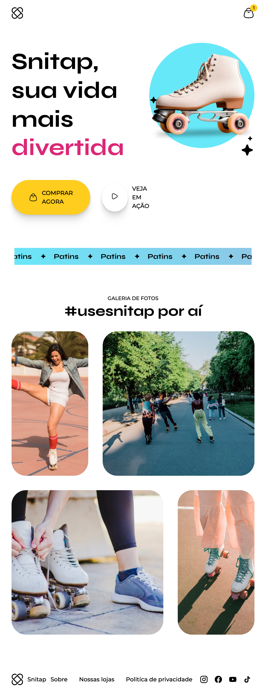

# 🛼 Snitap — Animated Landing Page

A modern and playful landing page for a fictional roller skate brand, designed to deliver a visually engaging experience through vibrant colors, smooth animations, and a responsive layout.

The project focuses on front-end development, CSS animations, and responsive web design, combining visual storytelling with a clean and modern interface.

## 📸 Project Preview



## 🚀 About the Project

Snitap is a landing page concept created to showcase a fictional roller skate brand.

The interface features a bold hero section, a prominent call-to-action, an animated text banner, and a photo gallery highlighting the skating experience.

The visual identity combines a minimalist layout with vibrant colors, rounded elements, and playful details to create an engaging user experience.

This project was developed as a learning experience to strengthen front-end development skills, with a focus on HTML, CSS, animations, and responsive layouts.

## ✨ Features

- **Hero Section:** A visually engaging introduction featuring the brand's main message and product imagery.
- **Call-to-Action Buttons:** Prominent buttons designed to encourage user interaction.
- **Animated Text Banner:** A scrolling text section that adds movement to the page.
- **Photo Gallery:** An image gallery showcasing roller skating and the brand's lifestyle.
- **Modern Visual Design:** A clean layout with vibrant colors, rounded corners, and expressive typography.
- **CSS Animations:** Animated elements and transitions that enhance the browsing experience.
- **Responsive Layout:** An interface designed to adapt to different screen sizes.
- **Social Media Links:** Footer navigation with social media icons.

## 🛠️ Technologies

The project focuses on front-end development using:

- **HTML5** — Semantic page structure and content organization.
- **CSS3** — Styling, layout, visual effects, and responsive design.
- **CSS Animations & Transitions** — Motion effects and interactive visual elements.
- **CSS Media Queries** — Responsive adjustments for different screen sizes.
- **Git & GitHub** — Version control and project hosting.

## 🎨 Design Highlights

The interface was designed around a playful and contemporary visual identity.

Key design elements include:

- A vibrant color palette featuring cyan, pink, and yellow.
- Bold typography that emphasizes the brand's message.
- Rounded image containers and buttons.
- A product-focused hero section.
- A lifestyle gallery that reinforces the brand's identity.
- Motion effects that bring the interface to life.

## 💻 Getting Started

Follow the instructions below to run the project locally.

### Prerequisites

You will need:

- A web browser, such as Google Chrome.
- Git installed on your computer.
- A code editor, such as Visual Studio Code.

### Installation

**1. Clone the repository**

```bash
git clone https://github.com/mussatograziela/lp-patins-animada.git
```

**2. Navigate to the project directory**

```bash
cd lp-patins-animada
```

**3. Open the project**

Open the project folder in Visual Studio Code.

If the project contains an `index.html` file in its root directory, you can open it directly in your browser or use the Live Server extension in Visual Studio Code to preview the page.

## 📚 Learning Outcomes

This project provided an opportunity to practice and improve front-end development skills, including:

- Structuring web pages with HTML5.
- Styling layouts with modern CSS techniques.
- Creating animations and transitions with CSS.
- Applying media queries to build responsive interfaces.
- Organizing visual elements to improve usability and readability.
- Translating a visual design into a functional web interface.
- Using Git and GitHub to manage and showcase a development project.

## 👩🏻‍💻 Author

**Graziela Jordana Mussato**

Front-End Developer | Business Administration Graduate | Finance & Operations Professional

Passionate about technology, problem-solving, and building intuitive digital experiences.

- **GitHub:** [@mussatograziela](https://github.com/mussatograziela)
- **LinkedIn:** [Graziela Jordana Mussato](https://www.linkedin.com/in/graziela-mussato/)
- **Linktree:** [mussato.graziela](https://linktr.ee/mussato.graziela)

---

⭐ If you find this project interesting, feel free to explore the repository!

**Built with 💜 and a passion for front-end development.**
